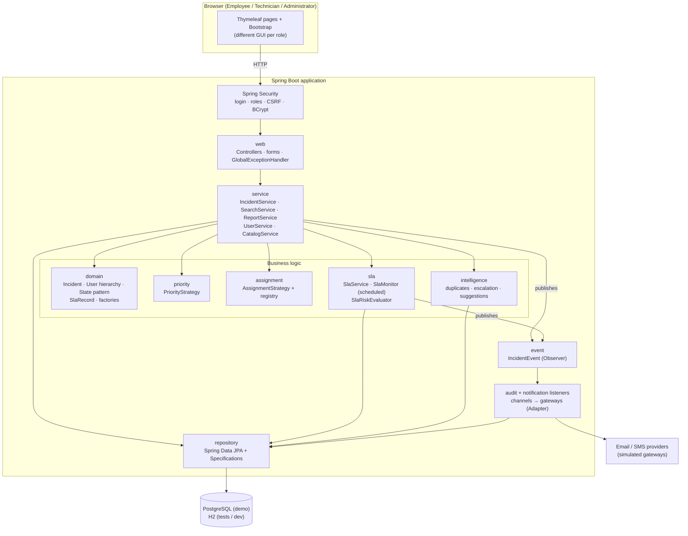
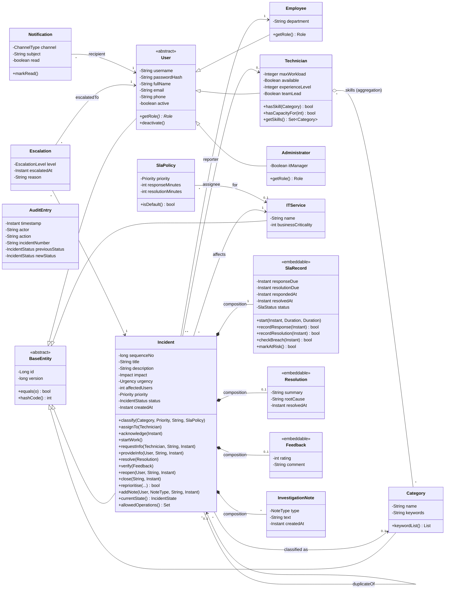
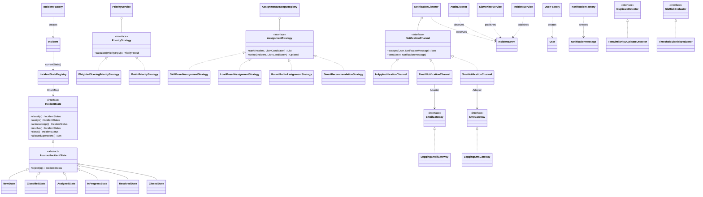
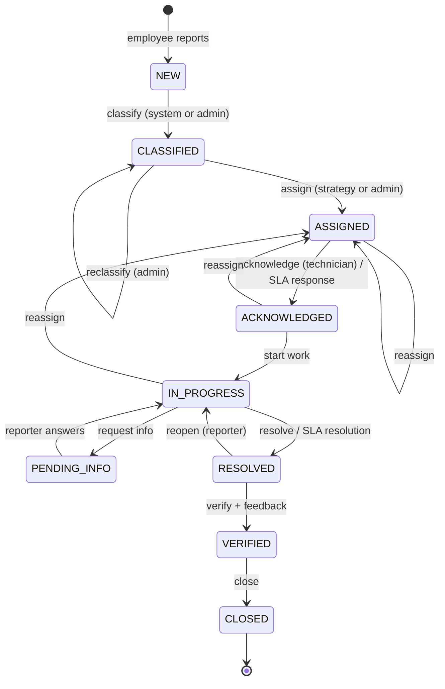
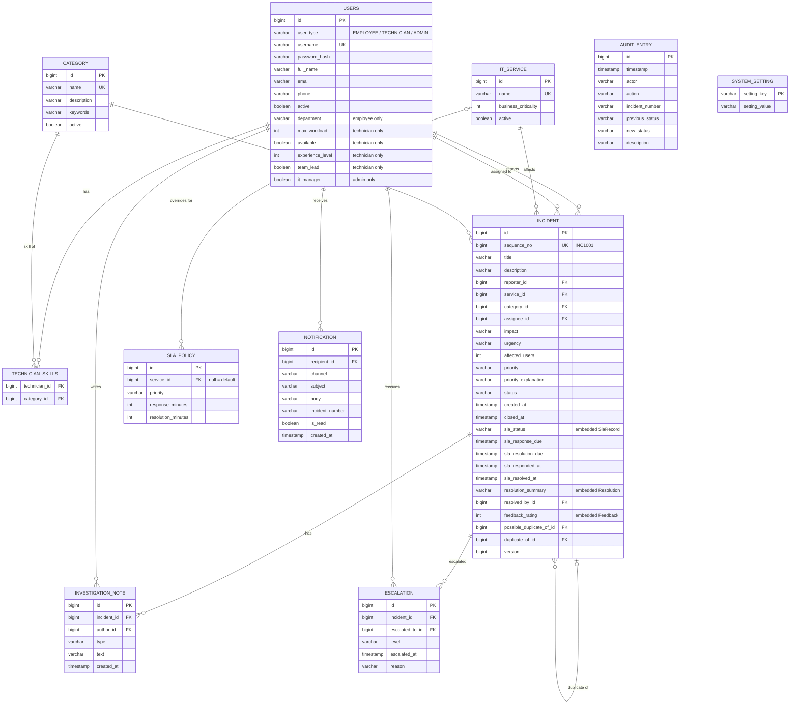
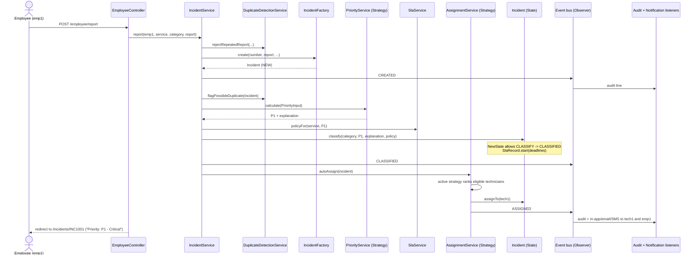

# I-ITSM diagrams

All diagrams are Mermaid, so they render on GitHub. To get images for the PDF report, paste each block into https://mermaid.live and export PNG/SVG. The use-case diagram is PlantUML ([use-case.puml](use-case.puml)); render it at https://www.plantuml.com/plantuml.

Contents:
1. Architecture
2. Domain class diagram
3. Design-pattern class diagram
4. Incident lifecycle (state diagram)
5. ER diagram
6. Sequence diagram: Workflow 1

---

## 1. Architecture (layered)

**Rules:**
- Controllers call services only.
- Services hold the use cases, while the domain objects enforce their own rules.
- Side effects (audit, notifications) happen only through events.

---

## 2. Domain model (class diagram)

**Notation:**
- `<|--` is inheritance ("is-a").
- `*--` is composition: the part lives and dies with the incident.
- `o--` is aggregation: categories exist on their own and are shared.
- `-->` is association.

`AuditEntry` stores the incident *number* as text on purpose, so audit history survives any change to the incident.

---

## 3. Design patterns (class diagram)

| Pattern | Where | Why |
|---|---|---|
| **State** | `IncidentState` + 9 state classes, `IncidentStateRegistry` | Each status allows only its own transitions. Illegal ones (NEW → CLOSED) are rejected in one place, with no `switch` on status. |
| **Strategy** | `PriorityStrategy`, `AssignmentStrategy`, `NotificationChannel` | Algorithms are interchangeable: priority via configuration, assignment at runtime by an admin, channels per role. |
| **Observer** | `IncidentEvent` → `AuditListener`, `NotificationListener` | Services don't know who reacts, so new reactions need no change to the services. |
| **Factory** | `IncidentFactory`, `UserFactory`, `NotificationFactory` | Creation rules (defaults, password hashing, message text) live in one place. |
| **Repository** | Spring Data interfaces, `IncidentSpecifications` | Persistence is hidden behind interfaces, and search filters can be composed. |
| **Adapter** | `EmailGateway` / `SmsGateway` (+ `ItsmUserPrincipal` for Spring Security) | External providers can be swapped without touching notification logic. |

---

## 4. Incident lifecycle (State pattern)

Any other move throws `InvalidStateTransitionException`. `IncidentStateTest` checks all 90 (status, operation) pairs.

---

## 5. ER diagram

**Sample data:** `DemoDataLoader` and `HistoricalIncidentSeeder` create 9 users, 7 services, 9 categories, the default SLA policies plus a Payment Gateway P1 override, and 28 past incidents with audit history.

---

## 6. Sequence: Workflow 1 (report → prioritise → assign → notify)

